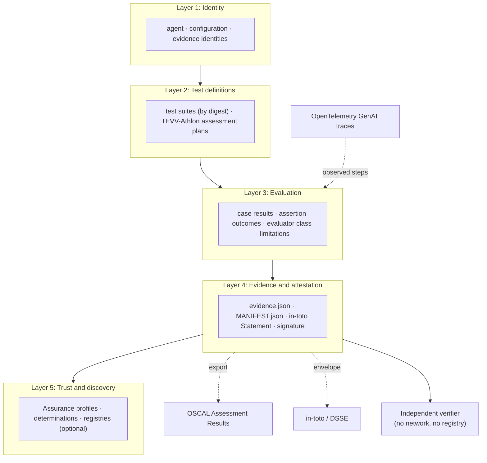

# Architecture and Technical Charter, v0.1 (draft)

> **Status:** Version 0.1.0, a draft, released 2026-11-22. Nothing here is stable before 1.0.
>
> **Name:** the AgentCarousel Specification ("AgentCarousel Spec" for short). It carries the
> AgentCarousel name because AgentCarousel founded and stewards it. Conformance never depends on an
> AgentCarousel product (see principle 1). Every machine-readable identifier uses the base
> `https://agentcarousel.com/spec/` (see [`schemas/BASE_URI`](schemas/BASE_URI)). Identifiers are
> names, and verifiers never fetch them (INV-6).

## 1. Mission

The AgentCarousel Specification is an open, vendor-neutral specification for producing,
exchanging, and independently verifying **evidence about how an AI agent behaved under test**.

Any organization should be able to test an agent and produce portable evidence. Any other
organization should be able to verify and consume that evidence without depending on the
producer's tooling, a particular model vendor, a governance platform, a cloud, or a registry.

> Trust is not a property an agent claims. It is a conclusion that people and systems draw from
> evidence they can check.

### Design principles

1. **Vendor neutrality.** The specification never requires a specific product, model provider,
   agent framework, or hosted service. Its name does not change that: conformance never requires
   the AgentCarousel CLI or the AgentCarousel registry, and the CLI is held to the same conformance
   kit as any other implementation.
2. **Evidence over assertions.** A document states what was tested, against which configuration,
   by which method, with what result, and what was *not* tested. It never states that an agent is
   "safe".
3. **Offline verifiability.** Integrity and conformance checks need only the evidence bundle and
   the verifier's own trust policy. No network access is required.
4. **Build on existing standards.** Use OpenTelemetry, [in-toto](https://in-toto.io/), OSCAL, and the NIST and OWASP
   reference models where they fit (section 7). Define new structures only for what is specific to
   agent evaluation.
5. **Specification over implementation.** If the reference implementation and the specification
   disagree, the specification wins and the implementation has a bug. A second implementation in
   another language is a release gate (section 11).

## 2. Scope and non-goals

**In scope:**

- How to identify the agent and the exact configuration that was evaluated.
- A portable record of an evaluation run: cases, assertions, evaluator methods, outcomes, and
  limitations.
- Binding that record to the tested artifacts by content digest, and packaging it so it can be
  signed and verified offline.
- Rules a verifier applies to decide whether evidence is intact, authentic, and conformant.
- Mappings to adjacent standards: OpenTelemetry traces, OSCAL assessment results, [in-toto](https://in-toto.io/)
  attestations, and NIST AI RMF.

**Non-goals:**

- **Not a safety certification.** Conformant evidence shows that a documented evaluation happened.
  It does not show that the agent is safe, compliant, or fit for any purpose.
- **Not runtime enforcement.** Gateways, policy engines, and approval workflows are out of scope.
  They may *consume* this evidence.
- **Not a GRC or inventory platform.** Governance platforms are expected consumers, not something
  this specification competes with.
- **Not a telemetry format.** Runtime traces use OpenTelemetry. This specification references
  traces and does not redefine them.
- **Not a single trust score.** No document defines a universal score. Assurance determinations
  are always relative to a named profile (section 8).

## 3. Architecture

Coverage of each layer in v0.1:

| Layer | v0.1 document | Normative in v0.1? |
|---|---|---|
| 1. Identity | [`spec/01-agent-identity.md`](spec/01-agent-identity.md), `schemas/0.1/agent.schema.json` | Yes |
| 2. Test definitions | [`spec/02-test-definitions.md`](spec/02-test-definitions.md) | **No (informative).** Suites are referenced by digest. A normative portable test schema will come through an RFC. |
| 3. Evaluation | [`spec/03-evidence.md`](spec/03-evidence.md), `schemas/0.1/evidence.schema.json` | Yes |
| 4. Evidence and attestation | [`spec/04-attestation.md`](spec/04-attestation.md), [`spec/05-verification.md`](spec/05-verification.md), `evidence-manifest` and `agent-evaluation-predicate` schemas | Yes |
| 5. Trust and discovery | [`spec/07-trust-profiles.md`](spec/07-trust-profiles.md) | **No (sketch).** Profiles will come through an RFC. |

## 4. Three identities

The Specification keeps three identities separate and never infers one from another:

1. **Agent identity.** The logical agent, such as `vulnerability-remediator`. It is a URI chosen by
   the producer, plus a version. It stays the same across deployments.
2. **Configuration identity.** The exact thing that was evaluated: model provider, name, and
   snapshot; the digest of the system prompt; the digest of the test suite; the tools and their
   scopes; the judge configuration. Two runs of the same agent against different models have
   different configuration identities.
3. **Evidence identity.** One evaluation run and the bundle that records it. It is identified by
   run id and by the content digests of the bundle's files.

Evidence is *about* a configuration identity. When a configuration identity changes (a new model
snapshot, an edited prompt, a new tool), earlier evidence no longer describes the new
configuration. Evidence freshness (section 8) depends on this rule.

## 5. Honesty invariants (normative)

Every conformant producer MUST satisfy these invariants, and every conformant verifier MUST check
those that can be checked mechanically. They exist because each one is a way evaluation evidence
commonly overstates what was shown.

| ID | Invariant |
|---|---|
| **INV-1** | A case that was not executed is reported as `not_tested` and is never counted as passed. Summary counts MUST equal the per-case statuses. |
| **INV-2** | Failures of cases marked `critical` are reported in their own count, regardless of any aggregate pass rate. |
| **INV-3** | Every trace step declares its `source`: `observed`, `mock`, or `fixture_expectation`. Evidence whose tool-call steps were not observed MUST carry the `tool_calls_not_observed` limitation. Such evidence MUST NOT be used to support claims about tool-call behavior. |
| **INV-4** | Every assertion outcome and score declares its evaluator class: `deterministic`, `golden`, `process`, or `llm_judge`. If every assertion on a critical case comes from `llm_judge`, the evidence MUST carry the `judge_only_assertion` limitation for that case. |
| **INV-5** | An evidence document is a function of exactly one evaluation run. Values derived from other runs (trends, history windows) MUST NOT appear in it. |
| **INV-6** | Verification requires no network access. Schema `$ref`s resolve locally, and signatures are checked against keys the verifier already holds. |
| **INV-7** | System prompts, credentials, and sensitive test inputs are excluded by default and represented by their digests. Disclosure is an explicit producer choice and is recorded in the evidence. |
| **INV-8** | Limitations are machine-readable (`{code, detail}`), so consumers can filter evidence by what it does *not* show. |

## 6. Reference implementation status

The AgentCarousel CLI (`agc`) is the reference implementation. Version 0.8.1 did not satisfy this
charter. Version 0.9.0 closed most gaps, 0.9.1 emits this draft's identifiers, and 0.10.1 is the
current release. Tool calls are
still synthesized, so no evidence from the reference implementation supports a claim about tool
behaviour. This table is kept current so that nobody, including AgentCarousel, overstates what the
reference implementation proves.

| Area | Before 0.9 (v0.8.1) | v0.9.1 and later (current: v0.10.1) | Spec requirement |
|---|---|---|---|
| Signing | Hashes only | minisign signature over `MANIFEST.json`, covering evidence and statement | §4 attestation |
| Offline verification | `trust-check` contacts the registry first | `agc verify` checks integrity, signature, and v0.1 conformance offline | INV-6 |
| Tool calls | Synthesized from the test's expected sequence | **Still synthesized.** Now labelled `fixture_expectation` with the `tool_calls_not_observed` limitation | INV-3 |
| Untested cases | Filtered cases disappear | Recorded as `not_tested`, never counted as passed | INV-1 |
| Evaluator disclosure | Not recorded | Recorded per score, including judge fallback to `auto_check` | INV-4 |
| Configuration binding | No prompt or suite digests; export mixes in history | Fixture, prompt, golden, and judge digests recorded; `evidence.json` built from one run | §4, INV-5 |
| Prompt disclosure | `prompt.md` uploaded whenever present | Withheld by default; `--include-prompt` to disclose | INV-7 |
| Agent identity | Free-text name only | Optional declared `agent` block; documented fallback id | §4 |
| Trust states | Registry tiers unsigned, never demoted, auto-promoted | Unchanged (registry not yet updated) | §8: not part of this specification |
| OSCAL Assessment Results | Built from compliance scores over recent run history | **Not aligned.** Still built from run history, not from `evidence.json`: one observation per assessed control rather than per case, every method `TEST` (including `llm_judge` scores), and custom properties without an `ns` | [spec/08 §8.3](spec/08-interop.md#83-oscal-assessment-results) |

## 7. Relationship to existing standards

| Standard | Role in this specification |
|---|---|
| **OpenTelemetry GenAI semantic conventions** (`invoke_agent`, `execute_tool`; Development stability) | Describe *what happened* at runtime. Observed trace steps may be derived from OTel spans. This specification does not define a trace format. See [`spec/08-interop.md`](spec/08-interop.md). |
| **[in-toto](https://in-toto.io/) Attestation Framework** (Statement v1, DSSE) | The integrity and provenance envelope. This specification defines one predicate type for agent evaluations and maps to the generic [in-toto](https://in-toto.io/) `test-result/v0.1` predicate. |
| **OSCAL** (Assessment Plan and Assessment Results) | How results are communicated to GRC tooling. Evidence defined here maps to Assessment Results. It does not replace them. |
| **TEVV-Athlon** (NIST AI 200-2) | The assessment-plan structure (goals → blocks → events) that a test suite can implement. It maps to an OSCAL Assessment Plan. |
| **NIST AI RMF 1.0** | A risk taxonomy for crosswalks only, never a certification basis. Every mapping pins the framework version. A revision of AI RMF 1.0 is in progress. |
| **OWASP agentic-AI threat guidance** | A source of adversarial scenarios for test suites and future profiles. |

## 8. Trust model

The Specification separates three concepts that are often merged into one "trust level":

1. **Evidence status.** Is there evidence, is it intact, and is it signed by a key the verifier
   trusts? Values: `none`, `integrity_only`, `verified`, `nonconformant`. A verifier computes this
   with no judgement involved.
2. **Assurance profile.** A named, versioned set of requirements for a class of agent. Examples:
   informational agents, tool-using agents, agents handling sensitive data, autonomous agents,
   agents operating critical systems. Profiles are *not* ascending levels. They will be defined
   through the RFC process.
3. **Assurance determination.** One evaluator's conclusion that specific evidence does or does not
   meet a specific profile version. Values: meets, meets with exceptions, does not meet,
   insufficient evidence, stale. A determination always names the evaluator, the profile version,
   the scope of the evidence, and its limitations. A relying party may always apply a stricter
   policy.

**Freshness.** Evidence is stale for a configuration whose identity (section 4) differs from the
one that was tested. Verifiers compare configuration digests. They do not use calendar age alone.

**Legacy vocabularies:** the AgentCarousel CLI and registry currently use two other trust
vocabularies. Neither is part of this specification.

| Existing vocabulary | Where | Status under this charter |
|---|---|---|
| `Experimental → CarouselCandidate → Stable → Trusted` | AgentCarousel registry | AgentCarousel registry listing policy. Not an evidence status or determination defined by this specification. Deprecated for specification purposes. |
| `certification_track: none / candidate / stable / trusted` | AgentCarousel fixture files | Declarative producer intent. Not part of this specification. Deprecated for specification purposes. |

## 9. Security and privacy defaults

- Prompts, credentials, and sensitive test inputs are excluded by default (INV-7). Producers record
  their digests so consumers can still check the configuration identity.
- Evidence bundles reject symlinks, hard links, path traversal, and files missing from the manifest.
- Signing keys are the producer's own. A registry is never required to hold or vouch for them.
- See [`spec/06-security-privacy.md`](spec/06-security-privacy.md) and [`SECURITY.md`](SECURITY.md).

## 10. Governance

- **Stage 1, founder-led (now):** a public RFC process, versioning and deprecation policy,
  conformance suite, and security disclosure process.
- **Stage 2:** a technical steering group that includes external implementers.
- **Stage 3:** independent stewardship, once there are independent implementations.

The specification, schemas, reference verifier, and conformance tests stay openly licensed. Hosted
services may add convenience but never exclusive access. See [`GOVERNANCE.md`](GOVERNANCE.md),
[`VERSIONING.md`](VERSIONING.md), and [`rfcs/`](rfcs/).

## 11. Roadmap and release gates

Releases are gated on interoperability, not on dates.

| Release | Gate |
|---|---|
| **0.1 (released as 0.1.0)** | Schemas, prose, and a conformance kit. The reference CLI emits conformant evidence, and the independent Python verifier in `conformance/` verifies it. |
| **0.2** | RFCs accepted for assurance profiles and dimensions, for a normative portable test-definition schema, and for DSSE-native signing. Observed tool calls exist in at least one implementation. |
| **0.9** | At least one producer not written by AgentCarousel emits conformant evidence, and at least two independent verifiers agree on the conformance vectors. |
| **1.0** | Stable identifiers resolve to the published schemas, and external implementers sit on the steering group. |

The most important test of the whole effort is this: **can an organization produce conformant
evidence without the AgentCarousel CLI, and can another organization verify it without the
AgentCarousel registry?**
